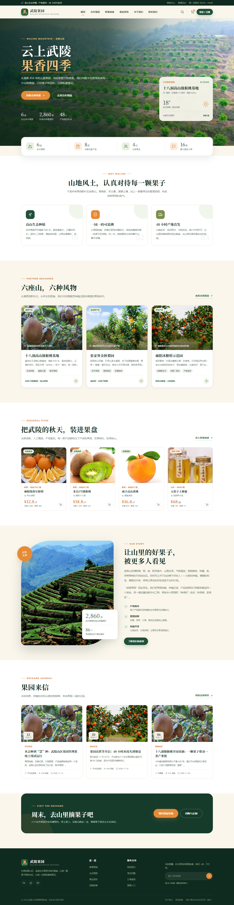

# 武陵山区果园管理系统

> 计算机应用技术专业毕业设计 · 多页面网站 · 前台商城 + 后台管理  
> 技术栈：HTML5 + CSS3 + 原生 JavaScript（ES6）+ localStorage + Canvas 2D  
> 零依赖、无需构建、离线可运行，配套完整毕业设计文档与答辩材料。



## 一、项目简介

“武陵山区果园管理系统”面向武陵山区中小型果园，围绕“果园展示、产品销售、订单履约、采摘预约、客户沟通”五类场景，提供前台商城与后台管理两个模块：

- **前台**：首页、合作果园、果园详情、鲜果商城、产品详情、购物车、结算、下单成功、果业资讯、关于我们、联系我们、登录注册、个人中心；
- **后台**：管理员登录、数据看板、订单管理、产品管理、果园管理、采摘预约、资讯管理、用户管理、留言管理、系统设置。

系统包含完整的“浏览—加购—下单—发货—收货”业务闭环，以及“预约—确认—完成”“留言—回复”辅助闭环。演示数据保存在浏览器 localStorage 中，后台可一键恢复初始数据，适合毕业设计现场演示。

## 二、快速开始

### 环境要求

- Windows 10/11
- Node.js 18+（推荐 20/22/24）
- Microsoft Edge / Google Chrome
- Visual Studio Code（开发/阅读源码）

### 方式一：一键启动（推荐）

双击项目根目录的：

```text
start.bat
```

脚本会自动启动本地服务器并打开：

```text
http://localhost:8080/index.html
```

### 方式二：命令行启动

```bash
cd "武陵山区果园管理系统-毕业设计"
node server.js
```

浏览器访问：

- 前台：http://localhost:8080/index.html
- 后台：http://localhost:8080/admin/login.html

### 方式三：VS Code Live Server

1. 用 VS Code 打开 `武陵山区果园管理系统-毕业设计` 文件夹；
2. 安装 Live Server 插件；
3. 右键 `index.html` → “Open with Live Server”。

> 不建议直接双击 HTML 文件（`file://`）。部分浏览器会限制 localStorage 在文件之间的共享，导致登录状态和购物车无法保持。

### 演示账号

| 角色 | 账号 | 密码 | 入口 |
|---|---|---|---|
| 普通用户 | `test`（或手机号 `13907430001`） | `123456` | 前台登录 |
| 管理员 | `admin` | `admin123` | 后台登录 |

## 三、功能清单

### 前台

- 首页品牌展示、核心数据、推荐果园/产品、资讯；
- 果园列表：产区筛选、关键词搜索；
- 果园详情：档案、品种、在售产品、采摘预约；
- 商城：分类筛选、搜索、价格/销量排序、快速加购；
- 产品详情：图片切换、数量控制、加购、立即购买、详情 Tab；
- 购物车：数量增减、移除、金额与运费计算；
- 结算：收货信息校验、配送/支付方式、提交订单；
- 下单成功：订单号、金额、收货信息；
- 登录/注册：账号或手机号登录、记住账号、注册校验；
- 个人中心：资料修改、密码修改、订单查看/取消/确认收货/再次购买、预约查看/取消；
- 资讯：分类、搜索、详情、上下篇、最近资讯；
- 联系：联系方式、留言、产区地图、FAQ。

### 后台

- 管理员登录、角色校验、退出；
- 数据看板：KPI、近 6 个月趋势、品类占比、最新订单、库存预警、热销产品、待办；
- 订单管理：搜索、筛选、详情、状态流转、取消、时间线、分页；
- 产品管理：新增、编辑、上下架、删除、库存、图片选择；
- 果园管理：新增、编辑、删除保护、产品数量；
- 预约管理：确认、完成、取消；
- 资讯管理：新增、编辑、草稿/发布、预览、删除；
- 用户管理：搜索、筛选、启停、重置密码、详情；
- 留言管理：查看、回复、删除；
- 系统设置：站点信息、JSON 导出/导入、恢复演示数据、系统信息。

## 四、项目结构

```text
武陵山区果园管理系统-毕业设计/
├── index.html                  # 前台首页
├── orchards.html               # 合作果园
├── orchard-detail.html         # 果园详情 + 预约
├── products.html               # 鲜果商城
├── product-detail.html         # 产品详情
├── news.html                   # 果业资讯
├── news-detail.html            # 资讯详情
├── about.html                  # 关于我们
├── contact.html                # 联系我们
├── login.html                  # 登录
├── register.html               # 注册
├── cart.html                   # 购物车
├── checkout.html               # 结算
├── order-success.html          # 下单成功
├── user.html                   # 个人中心
├── admin/                      # 后台 10 个页面
│   ├── login.html
│   ├── index.html              # 数据看板
│   ├── orders.html
│   ├── products.html
│   ├── orchards.html
│   ├── bookings.html
│   ├── news.html
│   ├── users.html
│   ├── messages.html
│   └── settings.html
├── assets/
│   ├── css/
│   │   ├── base.css            # 变量、重置、按钮、表单、Modal、Toast
│   │   ├── front.css           # 前台布局与组件
│   │   └── admin.css           # 后台布局与组件
│   ├── js/
│   │   ├── store.js            # 数据访问层（实体、业务规则、统计）
│   │   ├── ui.js               # 公共 UI、图标、图表、转义
│   │   ├── front.js            # 前台页面逻辑
│   │   └── admin.js            # 后台页面逻辑
│   └── img/                    # 本地实景照片/产品图/地图/图标
├── database/
│   └── schema.sql              # MySQL 8.0 建表 + 初始化数据
├── docs/
│   ├── 01-任务书.md
│   ├── 02-需求分析.md
│   ├── 03-系统设计.md
│   ├── 04-数据库设计.md
│   ├── 05-测试报告.md
│   ├── 06-总结.md
│   ├── 07-答辩演示稿.md
│   ├── screenshots/            # 系统截图
│   └── *.docx / *.pptx         # 毕业设计文档、任务书、答辩 PPT
├── tests/
│   ├── load-playwright.js      # 测试依赖与 Edge 路径自动探测
│   ├── e2e.js                  # 主流程端到端测试
│   ├── e2e-deep.js             # 深度业务流测试
│   ├── e2e-security.js         # 安全与幂等测试
│   └── screenshots/            # 测试截图（运行后生成）
├── package.json                # 测试依赖与脚本
├── server.js                   # 零依赖静态服务器
├── start.bat                   # 一键启动
└── README.md
```

## 五、技术说明

### 架构

```text
HTML 页面（前台 15 + 后台 10）
        ↓
front.js / admin.js（页面路由、表单、业务）
        ↓
ui.js（页头页脚、Toast、Modal、图表、转义）
        ↓
store.js（统一数据访问层：用户/果园/产品/订单/预约/资讯/留言/统计）
        ↓
localStorage（演示）  ←→  database/schema.sql（MySQL 8.0 生产设计）
```

### 关键设计

- **数据层统一封装**：页面不直接操作 localStorage，所有实体读写、库存、订单状态、统计都走 `DB` API；
- **订单快照**：订单明细保存商品名称、单价、规格、图片，历史订单不受产品改价/删除影响；
- **状态时间线**：每次订单状态变化写入 `timeline`，个人中心和后台可查看；
- **库存一致性**：下单校验 → 扣减库存/增加销量 → 清空购物车；取消订单恢复库存；
- **权限控制**：会话保存角色，后台每个页面校验 `isAdmin()`，非管理员跳转登录；
- **响应式**：CSS 变量 + Grid/Flex + 1120/900/720/420 四级断点；
- **原生图表**：Canvas 2D 手写折线图/环形图，按 `devicePixelRatio` 缩放；
- **零外部依赖**：无 CDN、无字体请求、无图片外链，离线可演示。

### 演示版与生产版的差异

| 项目 | 演示版 | 生产版建议 |
|---|---|---|
| 数据存储 | localStorage | MySQL 8.0 |
| 事务 | 无 | InnoDB 事务 + 行锁 |
| 登录 | 前端会话 | JWT/Session + 服务端鉴权 |
| 密码 | 明文（仅演示） | BCrypt/Argon2 |
| 支付 | 模拟 | 微信支付/支付宝 |
| 物流 | 手工更新状态 | 物流接口 |
| 图片 | 本地实景照片 | 对象存储 + CDN |

## 六、测试

### 自动化测试

```bash
# 先启动服务器
node server.js

# 另开终端执行
node tests/e2e.js
node tests/e2e-deep.js
node tests/e2e-security.js
```

测试依赖 Playwright Core 和本机 Edge。首次运行前，在项目根目录执行：

```bash
npm install
```

然后可运行：

```bash
npm run test:e2e
npm run test:deep
npm run test:security
# 或一次运行全部
npm test
```

测试脚本会自动查找 Edge 的常见安装路径；如 Edge 安装在自定义位置，可设置环境变量：

```powershell
$env:EDGE_PATH = "D:\Apps\Edge\Application\msedge.exe"
npm test
```

### 测试结果

- `tests/e2e.js`：43 项检查；
- `tests/e2e-deep.js`：17 项检查；
- `tests/e2e-security.js`：5 项检查（XSS 转义、脚本不执行、重复提交防护）；
- 合计 65 项，全部通过；
- 覆盖登录、购物车、下单、取消、库存恢复、预约、留言、后台 CRUD、权限控制、移动端菜单等。

测试详情见 [docs/05-测试报告.md](docs/05-测试报告.md)。

## 七、数据库

演示版使用 localStorage，不要求安装 MySQL。数据库设计见：

- [docs/04-数据库设计.md](docs/04-数据库设计.md)
- [database/schema.sql](database/schema.sql)

如需在 MySQL 中初始化：

```bash
mysql -u root -p < database/schema.sql
```

脚本会创建 `wuling_orchard` 数据库、10 张表和少量演示数据。生产环境请修改初始密码并使用哈希存储。

## 八、文档与答辩材料

| 文档 | 路径 |
|---|---|
| 任务书 | [docs/01-任务书.md](docs/01-任务书.md) |
| 需求分析 | [docs/02-需求分析.md](docs/02-需求分析.md) |
| 系统设计 | [docs/03-系统设计.md](docs/03-系统设计.md) |
| 数据库设计 | [docs/04-数据库设计.md](docs/04-数据库设计.md) |
| 测试报告 | [docs/05-测试报告.md](docs/05-测试报告.md) |
| 总结 | [docs/06-总结.md](docs/06-总结.md) |
| 答辩演示稿 / 常见问题 | [docs/07-答辩演示稿.md](docs/07-答辩演示稿.md) |
| 毕业设计说明书（Word） | `docs/武陵山区果园管理系统-毕业设计说明书.docx` |
| 任务书（Word） | `docs/武陵山区果园管理系统-任务书.docx` |
| 答辩 PPT | `docs/武陵山区果园管理系统-答辩PPT.pptx` |

## 九、演示路线（5 分钟）

1. 前台首页：品牌、果园、产品、资讯；
2. 商城：筛选鲜果 → 搜索猕猴桃 → 加入购物车；
3. 购物车：调整数量 → 去结算；
4. 登录：`test / 123456`；
5. 结算：确认地址 → 提交订单 → 记录订单号；
6. 后台：`admin / admin123` → 数据看板；
7. 订单管理：找到订单 → 发货；
8. 回前台个人中心：确认收货；
9. 果园详情：提交预约 → 后台确认（可选）；
10. 系统设置：导出/恢复演示数据（可选）。

## 十、常见问题

**Q：打开页面样式错乱或数据不共享？**  
A：请通过 `http://localhost:8080` 访问，不要直接双击 HTML 文件。建议使用 `start.bat` 或 `node server.js`。

**Q：端口 8080 被占用？**  
A：使用其他端口启动：

```bash
set PORT=8081 && node server.js
```

然后访问 `http://localhost:8081/index.html`。

**Q：后台登录失败？**  
A：确认使用 `admin / admin123`；如果之前登录过普通用户，先退出或清理站点数据。

**Q：数据被改乱了？**  
A：后台 → 系统设置 → 恢复演示数据 → 重新登录。操作前可先导出 JSON 备份。

**Q：为什么后台直接跳回登录页？**  
A：后台有角色校验，只有 `role = admin` 的账号可进入。普通用户账号密码正确也无法进入后台。

**Q：图片不显示？**  
A：确认通过本地服务器访问，且 `assets/img/` 目录完整；项目不依赖网络图片。

**Q：这是真实支付吗？**  
A：不是。演示版模拟支付成功，订单直接进入“待发货”，不会产生任何真实扣款。

## 十一、许可与声明

本项目为计算机应用技术专业毕业设计演示项目，果园、产品、订单、资讯、用户等数据均为虚构或教学示例，不用于真实交易。页面中的“武陵果园”品牌、联系方式、备案号均为演示内容。产品与果园实景照片来自公开网络资源（Pixabay、360 图片搜索等），仅用于教学演示；如需商业发布，请替换为已获得授权的图片。

如需将本项目用于真实业务，请务必：

1. 使用服务端和 MySQL 替换 localStorage；
2. 使用密码哈希、HTTPS、服务端鉴权和输入校验；
3. 接入合规的支付、物流、短信和隐私授权流程；
4. 获得果园、农户和消费者的数据使用授权。
