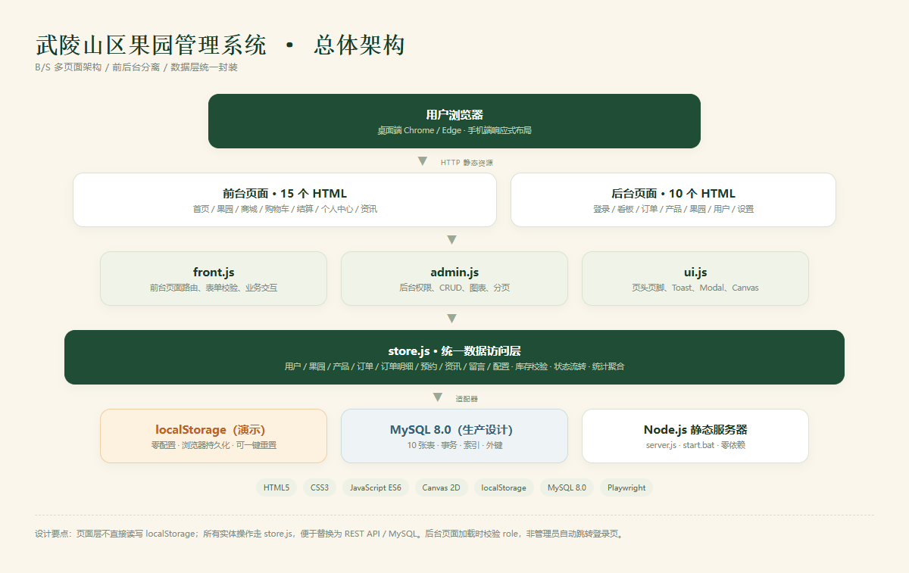
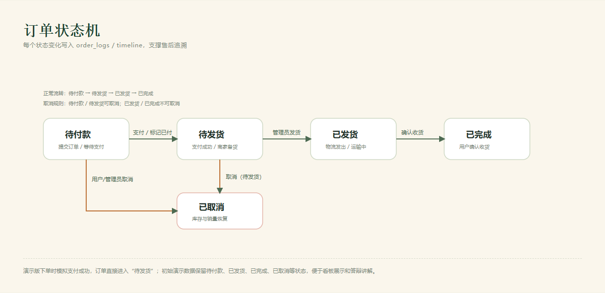
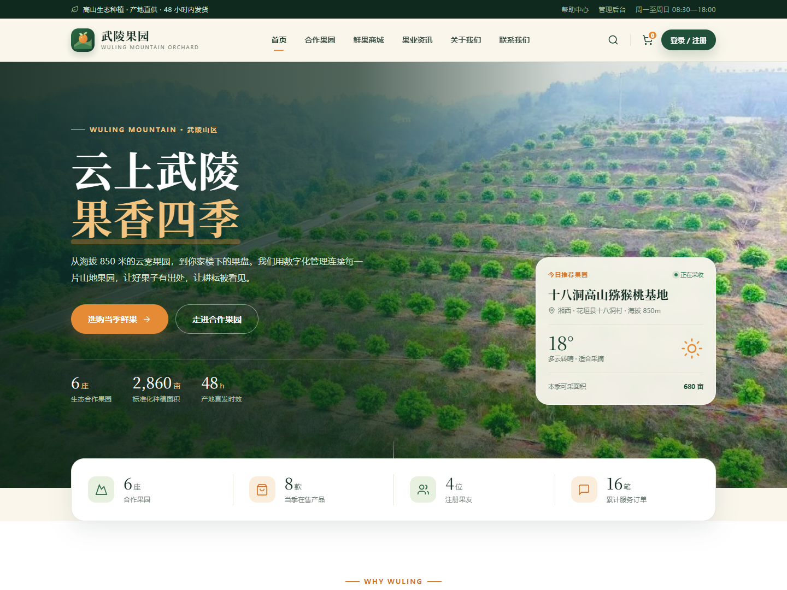
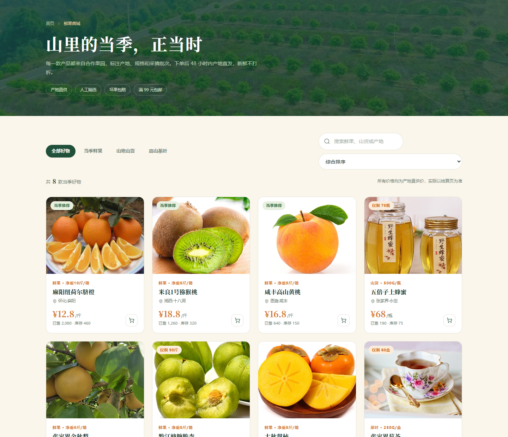
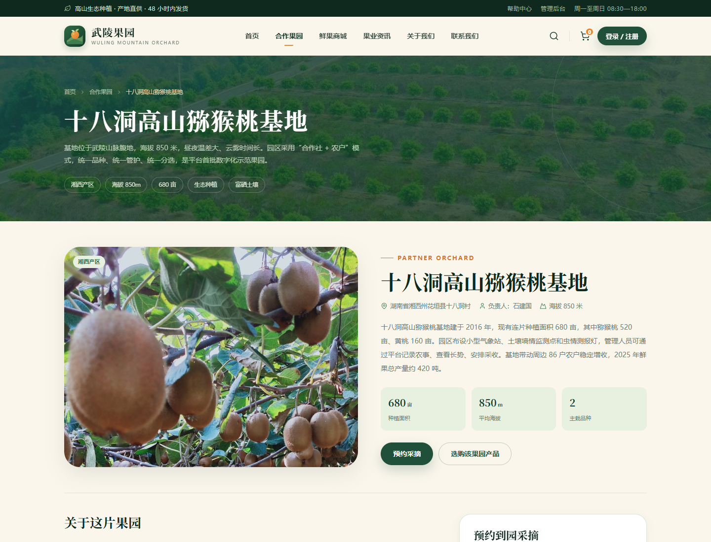
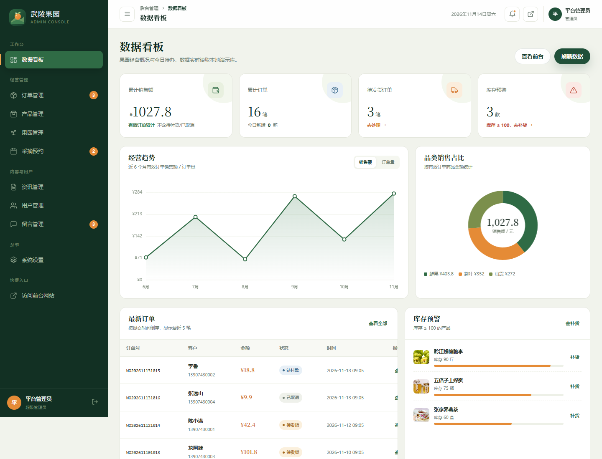
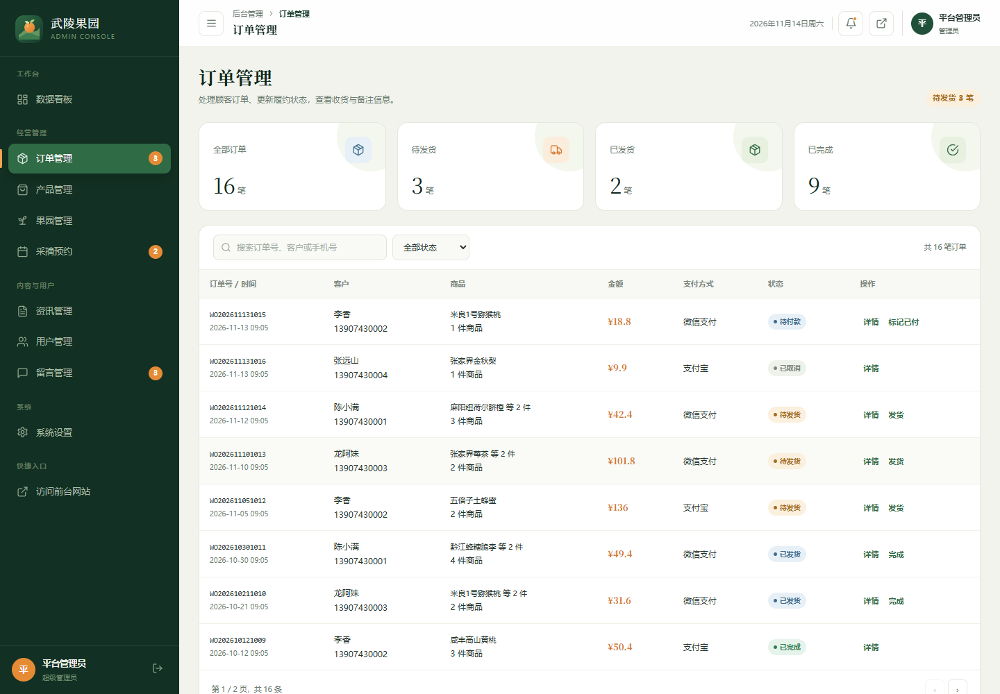
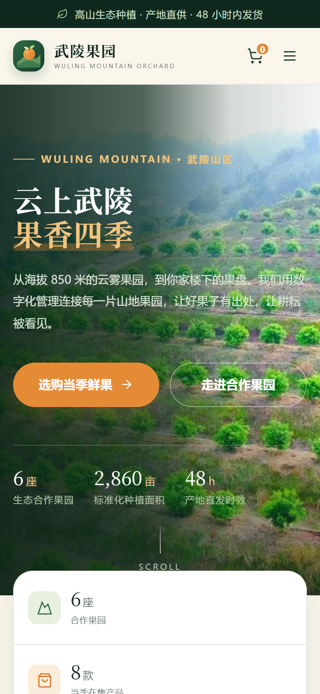

# 系统设计说明书

## 1 概述

### 1.1 设计目标

本系统面向武陵山区中小型果园，采用“前台商城 + 后台管理”的双模块结构，在浏览器中实现果园展示、产品选购、订单履约、采摘预约、资讯发布和客户沟通等业务。设计重点不是堆叠功能，而是用一套轻量、清晰、可维护的技术方案，把果园最常用的业务闭环跑通，并为后续接入真实数据库和支付、物流服务预留接口。

### 1.2 设计原则

1. **业务闭环优先**：优先保证“浏览—加购—下单—发货—收货”和“预约—确认—完成”两条主线完整；
2. **低耦合**：页面只负责结构与交互，数据读写集中在 `store.js`，公共 UI 集中在 `ui.js`；
3. **零依赖可演示**：不依赖 npm 包、CDN 和构建工具，双击 `start.bat` 即可运行；
4. **数据模型先行**：localStorage 实体与 MySQL 表结构保持一致，方便后续迁移；
5. **渐进增强**：基础内容在 HTML 中，交互和动态数据由 JavaScript 增强；
6. **可测试**：核心逻辑不依赖框架，便于用 Node.js 和 Playwright 做自动化验证。

## 2 总体架构

### 2.1 架构风格

系统采用 B/S（Browser/Server）架构下的**多页面应用（MPA）**。前台和后台均由多个 HTML 页面组成，页面之间通过相对路径跳转；每个页面引入公共的数据层、UI 层和业务脚本。演示环境没有独立的应用服务器，静态文件由 Node.js 零依赖服务器托管，数据保存在浏览器 localStorage 中。

```text
┌─────────────────────────────────────────────────────────────┐
│                         浏览器（Browser）                    │
│                                                             │
│  ┌──────────────────────┐      ┌──────────────────────┐     │
│  │      前台页面         │      │      后台页面         │     │
│  │  index / orchards    │      │  login / dashboard   │     │
│  │  products / cart     │      │  orders / products   │     │
│  │  user / news ...     │      │  users / settings... │     │
│  └──────────┬───────────┘      └──────────┬───────────┘     │
│             │                             │                 │
│      front.js（页面路由/业务）      admin.js（权限/CRUD）     │
│             └──────────────┬──────────────┘                 │
│                            ▼                                │
│                    ui.js（公共组件）                         │
│         页头页脚 / Toast / Modal / 图表 / 转义                │
│                            │                                │
│                            ▼                                │
│                 store.js（统一数据访问层）                    │
│      用户 / 果园 / 产品 / 订单 / 预约 / 资讯 / 留言 / 配置    │
│                            │                                │
│              ┌─────────────┴─────────────┐                  │
│              ▼                           ▼                  │
│      localStorage 适配器            MySQL 映射              │
│      （演示环境持久化）          （database/schema.sql）     │
└─────────────────────────────────────────────────────────────┘
```



### 2.2 分层说明

| 层次 | 主要文件 | 职责 |
|---|---|---|
| 表示层 | 25 个 HTML + base.css / front.css / admin.css | 页面结构、样式、响应式布局、语义化内容 |
| 公共 UI 层 | assets/js/ui.js | 图标、页头页脚、Toast、Modal、Confirm、空状态、Canvas 图表、HTML 转义 |
| 业务逻辑层 | assets/js/front.js、assets/js/admin.js | 页面路由、表单校验、筛选排序、购物车、下单、后台 CRUD、权限控制 |
| 数据访问层 | assets/js/store.js | 实体读写、业务规则、库存扣减、订单状态、统计聚合、导入导出 |
| 数据存储层 | localStorage / MySQL 8.0 | 演示数据持久化；关系型数据库落地脚本 |

### 2.3 请求与数据流

以“用户提交订单”为例：

1. 用户在 `checkout.html` 填写收货信息并提交；
2. `front.js` 调用 `DB.createOrder(data)`；
3. `store.js` 从当前会话读取用户，校验姓名、手机号、地址；
4. 读取购物车并校验商品是否上架、库存是否充足；
5. 扣减产品库存、增加销量，生成订单和订单明细快照；
6. 生成订单状态时间线，写入订单数组，清空购物车；
7. 返回订单对象，页面跳转 `order-success.html?no=订单号`；
8. 后台 `orders.html` 读取同一数据源，管理员更新订单状态；
9. 用户在 `user.html` 看到最新状态并确认收货。

整个过程没有服务端往返，所有校验在浏览器内完成。生产环境可将第 3—6 步迁移到服务端事务中，页面层保持不变。

## 3 技术选型

| 技术 | 用途 | 选择理由 |
|---|---|---|
| HTML5 | 页面结构 | 语义化标签、表单校验、原生 `dialog` 替代方案易实现 |
| CSS3 | 视觉与布局 | CSS 变量统一主题，Grid/Flex 实现复杂布局，媒体查询适配移动端 |
| JavaScript ES6 | 业务逻辑 | 原生模块化 IIFE、模板字符串、解构、Promise、可选链等 |
| localStorage | 演示数据持久化 | 零配置、刷新不丢失、方便答辩演示和重置 |
| Canvas 2D | 经营趋势图、品类占比图 | 不引入图表库，能体现原生绘图能力，体积小 |
| Node.js | 本地静态服务器 | 零依赖，解决 `file://` 下 localStorage 与相对路径问题 |
| Playwright Core | 端到端测试 | 复用本机 Edge，模拟真实点击、表单和跳转 |
| MySQL 8.0 | 生产数据库设计 | 关系模型清晰、支持 JSON 字段、索引和事务 |
| VS Code | 开发工具 | 轻量、中文生态好、内置终端和 Live Server 插件 |

> 没有使用 Vue/React 等框架，是为了满足“由多个 HTML 文件组成、用 VS Code 直接编辑”的毕业设计要求，同时把教学重点放在原生 Web 技术、数据建模和业务逻辑上。

## 4 功能模块设计

### 4.1 模块结构

```text
武陵山区果园管理系统
├── 前台商城
│   ├── 首页展示
│   ├── 合作果园（列表 / 详情 / 预约）
│   ├── 鲜果商城（列表 / 详情 / 购物车 / 结算 / 下单成功）
│   ├── 果业资讯（列表 / 详情）
│   ├── 关于我们
│   ├── 联系我们（留言 / FAQ）
│   ├── 登录注册
│   └── 个人中心（资料 / 订单 / 预约 / 安全）
└── 后台管理
    ├── 管理员登录
    ├── 数据看板
    ├── 订单管理
    ├── 产品管理
    ├── 果园管理
    ├── 采摘预约
    ├── 资讯管理
    ├── 用户管理
    ├── 留言管理
    └── 系统设置
```

### 4.2 页面清单

| 序号 | 页面 | 文件 | 主要功能 |
|---:|---|---|---|
| 1 | 首页 | `index.html` | 品牌展示、推荐果园/产品、资讯、数据统计 |
| 2 | 合作果园 | `orchards.html` | 果园列表、产区筛选、搜索、合作流程 |
| 3 | 果园详情 | `orchard-detail.html` | 果园档案、在售产品、采摘预约 |
| 4 | 鲜果商城 | `products.html` | 产品列表、分类、搜索、排序、加购 |
| 5 | 产品详情 | `product-detail.html` | 图片、价格、库存、加购、立即购买、详情 Tab |
| 6 | 果业资讯 | `news.html` | 资讯分类、搜索、列表 |
| 7 | 资讯详情 | `news-detail.html` | 正文、作者、阅读量、上下篇、相关资讯 |
| 8 | 关于我们 | `about.html` | 品牌故事、价值观、发展历程、团队分工 |
| 9 | 联系我们 | `contact.html` | 联系方式、留言表单、产区地图、FAQ |
| 10 | 登录 | `login.html` | 账号/手机号登录、记住账号、角色跳转 |
| 11 | 注册 | `register.html` | 注册校验、自动登录 |
| 12 | 购物车 | `cart.html` | 商品列表、数量调整、金额汇总、去结算 |
| 13 | 结算 | `checkout.html` | 收货信息、配送/支付方式、提交订单 |
| 14 | 下单成功 | `order-success.html` | 订单号、收货信息、金额、下一步入口 |
| 15 | 个人中心 | `user.html` | 资料、订单、预约、账户安全 |

| 序号 | 后台页面 | 文件 | 主要功能 |
|---:|---|---|---|
| 1 | 管理员登录 | `admin/login.html` | 角色校验、登录跳转 |
| 2 | 数据看板 | `admin/index.html` | KPI、趋势图、品类图、最新订单、库存预警、待办 |
| 3 | 订单管理 | `admin/orders.html` | 搜索、筛选、详情、状态流转 |
| 4 | 产品管理 | `admin/products.html` | 产品 CRUD、上架/下架、库存 |
| 5 | 果园管理 | `admin/orchards.html` | 果园 CRUD、产品数量、状态 |
| 6 | 采摘预约 | `admin/bookings.html` | 预约查询、确认、完成、取消 |
| 7 | 资讯管理 | `admin/news.html` | 资讯 CRUD、草稿/发布、预览 |
| 8 | 用户管理 | `admin/users.html` | 用户查询、启停、重置密码 |
| 9 | 留言管理 | `admin/messages.html` | 查看、回复、删除 |
| 10 | 系统设置 | `admin/settings.html` | 站点配置、导入导出、重置、系统信息 |

## 5 核心业务设计

### 5.1 订单状态机

```text
                 支付成功/管理员标记
    待付款 ───────────────────────► 待发货
       │                              │
       │ 用户/管理员取消               │ 管理员发货
       ▼                              ▼
    已取消 ◄────────────────────── 已发货
       ▲                              │
       │ 取消（仅待付款/待发货）         │ 用户确认收货
       └────────────────────────── 已完成
```

状态规则：

| 当前状态 | 可执行操作 | 操作者 | 库存影响 |
|---|---|---|---|
| 待付款 | 标记已付款、取消 | 管理员；用户/管理员取消 | 取消时恢复库存 |
| 待发货 | 发货、取消 | 管理员；用户/管理员取消 | 取消时恢复库存 |
| 已发货 | 完成 | 管理员；用户确认收货 | 不变 |
| 已完成 | 查看、再次购买 | 用户 | 不变 |
| 已取消 | 查看 | — | 已恢复 |

演示版下单时模拟支付成功，订单直接进入“待发货”；初始演示数据中包含“待付款”“已发货”“已完成”“已取消”等状态，便于看板展示。



### 5.2 购物车设计

- 购物车按用户隔离：游客使用 `cart_guest`，登录用户使用 `cart_user_<userId>`；
- 登录时调用 `mergeGuestCart` 将游客购物车合并到用户购物车，同产品数量相加；
- 加购时校验产品状态、库存，数量上限为当前库存；
- 修改数量时再次校验库存；数量为 0 时移除；
- 产品删除时同步从购物车移除；
- 结算时以购物车实时数据为准重新计算金额，不信任页面显示值。

### 5.3 金额计算

```text
商品金额 = Σ（商品单价 × 数量）
运费     = 商品金额 ≥ 99 元 ? 0 : 10 元
应付总额 = 商品金额 + 运费
```

金额统一使用 `round2()` 保留两位小数。订单明细保存下单时的商品名称、单价、规格、图片快照，避免产品后续修改影响历史订单。

### 5.4 预约状态机

```text
待确认 ──管理员确认──► 已确认 ──到访完成──► 已完成
   │                       │
   └────用户/管理员取消─────┴────► 已取消
```

校验规则：

- 必须登录；
- 联系人不能为空，手机号必须为 11 位；
- 到访日期不得早于今天；
- 人数 1—20；
- 同一用户、同一果园、同一天不能重复提交未取消预约。

### 5.5 权限与会话

- 用户表通过 `role` 区分 `admin` 和 `user`；
- 登录成功后在 `session` 中保存 `{id, role, loginAt}`；
- 前台个人中心调用 `getCurrentUser()`，未登录跳转登录页；
- 后台每个页面加载时调用 `DB.isAdmin()`，非管理员跳转后台登录页；
- 被停用的账号无法登录，已登录的会话在读取用户时失效；
- 后台登录页也会校验角色，普通用户即使密码正确也不能进入后台。

## 6 数据层设计

### 6.1 localStorage 键设计

| 键 | 实体 | 说明 |
|---|---|---|
| `wuling_orchard_v1_users` | 用户 | 管理员和普通用户 |
| `wuling_orchard_v1_orchards` | 果园 | 合作果园档案 |
| `wuling_orchard_v1_products` | 产品 | 商品信息 |
| `wuling_orchard_v1_orders` | 订单 | 订单主表 + 明细 + 状态时间线 |
| `wuling_orchard_v1_news` | 资讯 | 文章 |
| `wuling_orchard_v1_messages` | 留言 | 咨询与回复 |
| `wuling_orchard_v1_bookings` | 预约 | 采摘预约 |
| `wuling_orchard_v1_settings` | 配置 | 站点信息 |
| `wuling_orchard_v1_session` | 会话 | 当前登录用户 |
| `wuling_orchard_v1_cart_guest` | 购物车 | 游客购物车 |
| `wuling_orchard_v1_cart_user_<id>` | 购物车 | 用户购物车 |
| `wuling_orchard_v1_initialized` | 初始化标记 | 版本与初始化时间 |

### 6.2 数据访问层 API

| 分类 | 主要 API |
|---|---|
| 初始化 | `init()`、`seed()`、`resetDemo()`、`exportData()`、`importData()` |
| 用户 | `login()`、`loginAdmin()`、`register()`、`logout()`、`getCurrentUser()`、`isAdmin()`、`updateProfile()`、`changePassword()` |
| 购物车 | `addToCart()`、`updateCartQty()`、`removeCartItem()`、`getCartDetailed()`、`cartTotal()`、`cartCount()` |
| 产品 | `getProducts()`、`getProduct()`、`saveProduct()`、`deleteProduct()`、`productsByOrchard()` |
| 果园 | `getOrchards()`、`getOrchard()`、`saveOrchard()`、`deleteOrchard()` |
| 订单 | `createOrder()`、`cancelOrder()`、`updateOrderStatus()`、`confirmOrder()`、`getOrdersByUser()` |
| 预约 | `addBooking()`、`updateBookingStatus()`、`cancelBooking()`、`deleteBooking()` |
| 资讯 | `getNews()`、`saveNews()`、`deleteNews()`、`increaseNewsViews()` |
| 留言 | `addMessage()`、`replyMessage()`、`deleteMessage()` |
| 统计 | `getStats()` |

### 6.3 数据一致性策略

- **库存扣减**：创建订单前逐项校验库存，校验通过后再统一扣减，避免部分失败导致数据不一致；
- **订单快照**：订单明细保存商品快照，产品改价或删除不影响历史订单；
- **取消恢复**：取消待付款/待发货订单时恢复库存和销量，并记录状态日志；
- **重复提交防护**：结算按钮提交后禁用，防止连续点击生成多笔订单；
- **演示数据重置**：清空所有业务键后重新写入初始数据，用于答辩前恢复干净环境。

> localStorage 不具备事务能力。演示版通过“先校验、后写入”和单线程执行降低风险；生产环境应在 MySQL 中使用事务和行锁保证并发一致性。

## 7 界面与交互设计

### 7.1 视觉风格

- **主题色**：森林绿 `#163b2b` / `#2f6b45`，柑橘橙 `#e58b36`，米白 `#faf6ec`；
- **字体**：标题使用宋体/思源宋体风格，正文使用微软雅黑/PingFang SC；
- **图形**：本地实景照片配 SVG 图标与产区地图，果园、果实和山地场景统一为真实影像；
- **圆角与阴影**：大圆角、柔和阴影，强调自然、温暖、可信赖；
- **动效**：滚动显现、卡片悬浮、图片缓慢放大，均尊重 `prefers-reduced-motion`。

### 7.2 公共组件

| 组件 | 实现 | 复用页面 |
|---|---|---|
| 页头/页脚 | `ui.js` 动态渲染 | 全部前台页面 |
| 移动端抽屉菜单 | `.mobile-nav` + `open` 类 | 全部前台页面 |
| 用户下拉菜单 | `.user-menu` + 点击外部关闭 | 全部前台页面 |
| Toast | `UI.toast()` | 前后台 |
| Modal / Confirm | `UI.modal()` / `UI.confirm()` | 前后台 |
| 空状态 | `UI.emptyState()` | 列表/购物车/订单等 |
| 状态徽章 | `UI.statusBadge()` | 订单、预约、留言、用户 |
| Canvas 图表 | `UI.drawLineChart()` / `drawDonutChart()` | 后台看板 |
| 分页器 | `pagerHTML()` + `bindPager()` | 后台列表 |

### 7.3 响应式设计

| 断点 | 主要调整 |
|---|---|
| ≤ 1120px | 产品网格 4→3 列，首页主视觉单列，页脚三列 |
| ≤ 900px | 主导航隐藏，显示移动菜单；详情页、购物车、个人中心单列 |
| ≤ 720px | 产品网格 2 列，统计卡片 2 列，表单单列，页脚两列 |
| ≤ 420px | 产品网格 1 列，统计卡片 1 列，按钮占满宽度 |

### 7.4 交互细节

- 表单错误在字段下方即时提示，提交时聚焦第一个错误字段；
- 加购、保存、删除、回复等操作均有 Toast 反馈；
- 危险操作（删除、取消订单、重置数据）使用二次确认；
- 后台表格空数据时显示提示行，前台列表空数据时显示空状态和返回入口；
- 图表随窗口大小重绘，适配高分屏 `devicePixelRatio`；
- 页面切换后保留登录状态、购物车和筛选结果（同一页面内）。

## 8 安全设计

| 风险 | 措施 | 说明 |
|---|---|---|
| XSS | 所有用户输入在输出时经过 `escape()` 转义 | 产品名、留言、地址、资讯标题等 |
| 越权访问 | 后台页面加载时校验 `role` | 普通用户无法进入后台 |
| 弱口令 | 注册密码至少 6 位；管理员可重置 | 演示账号仅用于展示 |
| 重复提交 | 结算按钮禁用、订单号唯一 | 降低重复订单概率 |
| 数据泄露 | 不在页面展示密码；导出需管理员 | 演示版密码仍为明文，生产需哈希 |
| 路径穿越 | Node 静态服务器校验文件路径前缀 | 防止读取项目外文件 |
| 恶意导入 | 导入时校验 JSON 结构和允许字段 | 只写入白名单键 |

> 本系统为教学演示项目，未实现 HTTPS、CSRF、防暴力破解、审计日志等生产能力。生产部署时应补充服务端鉴权、参数校验、限流、日志和数据库备份。

## 9 部署与运行设计

### 9.1 开发环境

- 操作系统：Windows 10/11；
- 编辑器：Visual Studio Code；
- 浏览器：Microsoft Edge / Google Chrome；
- 运行时：Node.js 18+（推荐 20/22/24）；
- 数据库（设计）：MySQL 8.0。

### 9.2 运行方式

**方式一：一键启动（推荐）**

双击项目根目录的 `start.bat`，脚本会启动 Node 静态服务器并打开 `http://localhost:8080/index.html`。

**方式二：命令行**

```bash
cd "武陵山区果园管理系统-毕业设计"
node server.js
```

**方式三：VS Code Live Server**

在 VS Code 中安装 Live Server 插件，右键 `index.html` → “Open with Live Server”。建议使用服务器方式而不是直接双击 HTML，以保证 localStorage 在页面间共享。

### 9.3 生产部署建议

1. 将静态文件部署到 Nginx 或对象存储；
2. 将 `store.js` 的数据读写替换为 REST API 调用；
3. 使用 MySQL 8.0 执行 `database/schema.sql`；
4. 服务端使用 Spring Boot / Node.js / PHP 等实现鉴权、订单事务和库存锁；
5. 接入微信支付/支付宝、短信、物流查询和对象存储；
6. 配置 HTTPS、日志、备份和监控。

## 10 关键技术与设计亮点

1. **零依赖多页面架构**：25 个 HTML 页面，公共页头页脚和组件由原生 JavaScript 渲染，既保留多页面结构，又避免重复维护；
2. **统一数据访问层**：所有实体读写、业务规则和统计聚合集中在 `store.js`，页面不直接操作 localStorage，便于替换为 MySQL；
3. **完整的状态流转**：订单、预约、留言均有明确状态和操作边界，并记录状态时间线；
4. **库存一致性处理**：下单校验、扣减、取消恢复、购物车同步形成闭环；
5. **原生 Canvas 图表**：手写折线图和环形图，适配高分屏，体现绘图与数据处理能力；
6. **响应式与可访问性**：四级断点、移动抽屉、键盘焦点、语义化标签、`prefers-reduced-motion`；
7. **自动化测试**：Playwright 复用本机 Edge，覆盖 65 项检查，能回归核心业务；
8. **文档与实现一致**：页面清单、数据表、字段、测试用例均与代码对应，便于答辩讲解和后续维护。

## 11 系统界面展示

### 11.1 前台首页



首页采用“山地插画 + 深绿主视觉 + 米白内容区”的设计，突出武陵山区的自然感与产地信任。页面从上到下依次为品牌主视觉、核心数据、服务特色、合作果园、当季产品、品牌故事、果园资讯和采摘预约入口。

### 11.2 鲜果商城



商城使用 4 列产品卡片，展示产品图、品类、规格、产地、价格、销量和库存。顶部提供分类筛选、关键词搜索和排序；卡片右下角的购物车按钮支持快速加购。

### 11.3 果园详情与预约



果园详情页左侧展示果园档案、种植面积、海拔和主栽品种，右侧为粘性预约表单。预约表单在登录后自动带出姓名和手机号，并校验日期、人数和重复预约。

### 11.4 后台数据看板



后台看板由 KPI 卡片、经营趋势折线图、品类销售环形图、最新订单、库存预警、热销产品和待办提醒组成。图表使用 Canvas 2D 原生绘制，支持销售额/订单量切换和窗口自适应。

### 11.5 后台订单管理



订单管理使用“筛选 + 表格 + 分页 + 详情弹窗”的结构。管理员可以查看收货信息、商品明细、金额和状态时间线，并根据当前状态执行发货、完成或取消操作。

### 11.6 移动端适配



移动端隐藏主导航，使用抽屉菜单；产品、果园、资讯卡片改为单列或双列，统计卡片和数据表格自适应。390px 宽度下无横向滚动。
