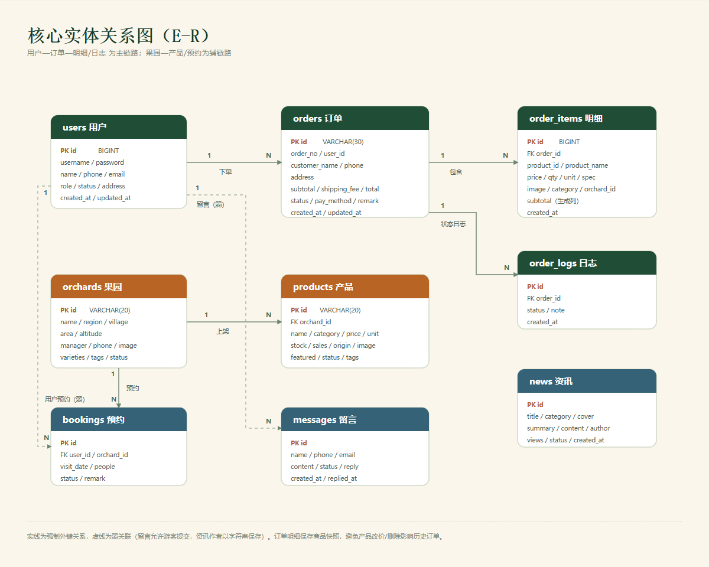

# 数据库设计说明书

## 1 设计概述

### 1.1 设计目标

数据库设计围绕“用户—果园—产品—订单—服务”五类核心对象展开，满足以下要求：

1. 能够完整保存前台展示、购物下单、后台履约、采摘预约、留言回复等业务数据；
2. 实体关系清晰，避免明显的数据冗余，同时保留订单商品快照；
3. 字段类型、长度、约束与页面表单、JavaScript 实体保持一致；
4. 支持按订单状态、产品品类、创建时间等常用条件查询；
5. 为后续从 localStorage 迁移到 MySQL 提供可直接执行的建表脚本。

### 1.2 命名规范

| 对象 | 规范 | 示例 |
|---|---|---|
| 数据库 | 小写下划线 | `wuling_orchard` |
| 表名 | 小写复数名词 | `users`、`orchards`、`orders` |
| 字段 | 小写下划线 | `order_no`、`created_at` |
| 主键 | `id` | `id` |
| 外键 | `<实体>_id` | `user_id`、`orchard_id` |
| 索引 | `idx_<表>_<字段>` | `idx_orders_status_created` |
| 唯一索引 | `uk_<表>_<字段>` | `uk_orders_no` |
| 外键约束 | `fk_<表>_<实体>` | `fk_products_orchard` |

### 1.3 字符集与存储引擎

- 字符集：`utf8mb4`，支持中文、emoji 和生僻字；
- 排序规则：`utf8mb4_0900_ai_ci`；
- 存储引擎：InnoDB，支持事务、行锁和外键；
- 时间类型：`DATETIME`，由应用层或数据库默认值维护。

## 2 概念模型

### 2.1 实体识别

| 实体 | 说明 | 主要属性 |
|---|---|---|
| 用户 User | 消费者或管理员 | 用户名、密码、姓名、手机号、角色、状态 |
| 果园 Orchard | 合作种植基地 | 名称、产区、地址、面积、海拔、负责人 |
| 产品 Product | 果园上架的商品 | 名称、品类、价格、规格、库存、销量 |
| 订单 Order | 一次购买行为 | 订单号、收货信息、金额、状态 |
| 订单明细 OrderItem | 订单中的商品快照 | 商品名、单价、数量、规格 |
| 订单日志 OrderLog | 订单状态变化记录 | 状态、说明、时间 |
| 资讯 News | 平台文章 | 标题、栏目、正文、作者、阅读量 |
| 留言 Message | 客户咨询 | 称呼、手机号、内容、回复 |
| 预约 Booking | 果园到访预约 | 联系人、日期、人数、状态 |
| 配置 Setting | 站点参数 | 键、值 |

### 2.2 实体关系

```text
用户 1 ────── N 订单 1 ────── N 订单明细
  │                 │
  │                 └────── N 订单日志
  │
  └────── N 预约 N ────── 1 果园 1 ────── N 产品
                                      │
                                      └────── N 订单明细（快照关联）

用户 1 ────── N 留言（留言不强制绑定用户，游客也可提交）
用户 1 ────── N 资讯（作者为用户/运营人员）
站点配置为独立键值表
```



### 2.3 主要关系说明

| 关系 | 基数 | 说明 |
|---|---|---|
| 用户—订单 | 1:N | 一个用户可有多笔订单；订单必须归属一个用户 |
| 订单—订单明细 | 1:N | 一笔订单包含多个商品，删除订单级联删除明细 |
| 订单—订单日志 | 1:N | 记录每次状态变化，便于售后追溯 |
| 果园—产品 | 1:N | 一个果园可上架多个产品；产品可暂不归属果园 |
| 用户—预约 | 1:N | 一个用户可预约多个果园 |
| 果园—预约 | 1:N | 一个果园可接待多个预约 |
| 用户—留言 | 1:N（弱） | 留言允许游客提交，因此不设强制外键 |
| 用户—资讯 | 1:N（弱） | 作者以字符串保存，便于外部作者投稿 |

## 3 逻辑模型

### 3.1 表清单

| 序号 | 表名 | 中文名 | 预估数据量 | 说明 |
|---:|---|---|---|---|
| 1 | `users` | 用户表 | 千级 | 管理员与普通用户 |
| 2 | `orchards` | 果园表 | 百级 | 合作果园档案 |
| 3 | `products` | 产品表 | 千级 | 商品信息 |
| 4 | `orders` | 订单表 | 万级 | 订单主表 |
| 5 | `order_items` | 订单明细表 | 十万级 | 商品快照 |
| 6 | `order_logs` | 订单日志表 | 十万级 | 状态流转 |
| 7 | `news` | 资讯表 | 千级 | 内容运营 |
| 8 | `messages` | 留言表 | 万级 | 客户咨询 |
| 9 | `bookings` | 预约表 | 万级 | 采摘预约 |
| 10 | `site_settings` | 配置表 | 百级 | 键值配置 |

## 4 表结构详细设计

### 4.1 用户表 `users`

| 字段 | 类型 | 约束 | 默认值 | 说明 |
|---|---|---|---|---|
| `id` | BIGINT UNSIGNED | PK, AUTO_INCREMENT | — | 用户主键 |
| `username` | VARCHAR(50) | NOT NULL, UNIQUE | — | 登录用户名 |
| `password` | VARCHAR(100) | NOT NULL | — | 密码；演示版明文，生产用哈希 |
| `name` | VARCHAR(50) | NOT NULL | — | 姓名/昵称 |
| `phone` | VARCHAR(20) | NOT NULL, UNIQUE | — | 手机号 |
| `email` | VARCHAR(120) | NULL | NULL | 邮箱 |
| `role` | ENUM('admin','user') | NOT NULL | 'user' | 角色 |
| `status` | ENUM('正常','停用') | NOT NULL | '正常' | 账号状态 |
| `address` | VARCHAR(255) | NULL | NULL | 默认收货地址 |
| `created_at` | DATETIME | NOT NULL | CURRENT_TIMESTAMP | 注册时间 |
| `updated_at` | DATETIME | NOT NULL | CURRENT_TIMESTAMP ON UPDATE | 更新时间 |

**业务约束**：用户名和手机号唯一；管理员账号不允许被停用；停用用户不能登录。

### 4.2 果园表 `orchards`

| 字段 | 类型 | 约束 | 默认值 | 说明 |
|---|---|---|---|---|
| `id` | VARCHAR(20) | PK | — | 果园编号，如 O001 |
| `name` | VARCHAR(100) | NOT NULL | — | 果园名称 |
| `region` | VARCHAR(30) | NOT NULL | — | 产区 |
| `village` | VARCHAR(150) | NOT NULL | — | 详细地址 |
| `area` | DECIMAL(10,1) | NOT NULL | 0 | 面积（亩） |
| `altitude` | INT | NOT NULL | 0 | 平均海拔（米） |
| `manager` | VARCHAR(50) | NULL | NULL | 负责人 |
| `phone` | VARCHAR(20) | NULL | NULL | 联系电话 |
| `image` | VARCHAR(255) | NULL | NULL | 封面图 |
| `varieties` | JSON | NULL | NULL | 主栽品种数组 |
| `tags` | JSON | NULL | NULL | 标签数组 |
| `intro` | VARCHAR(500) | NULL | NULL | 简介 |
| `detail` | TEXT | NULL | NULL | 详细介绍 |
| `status` | ENUM('正常','暂停合作') | NOT NULL | '正常' | 合作状态 |
| `created_at` | DATETIME | NOT NULL | CURRENT_TIMESTAMP | 创建时间 |
| `updated_at` | DATETIME | NOT NULL | CURRENT_TIMESTAMP ON UPDATE | 更新时间 |

**业务约束**：删除果园前需检查是否仍有产品，避免产品失去归属；演示版通过 `deleteOrchard()` 校验。

### 4.3 产品表 `products`

| 字段 | 类型 | 约束 | 默认值 | 说明 |
|---|---|---|---|---|
| `id` | VARCHAR(20) | PK | — | 产品编号，如 P001 |
| `orchard_id` | VARCHAR(20) | FK, NULL | NULL | 所属果园 |
| `name` | VARCHAR(100) | NOT NULL | — | 产品名称 |
| `category` | ENUM('鲜果','山货','茶叶') | NOT NULL | '鲜果' | 品类 |
| `price` | DECIMAL(10,2) | NOT NULL | — | 单价（元） |
| `unit` | VARCHAR(10) | NOT NULL | '斤' | 计价单位 |
| `spec` | VARCHAR(50) | NULL | NULL | 规格 |
| `stock` | INT UNSIGNED | NOT NULL | 0 | 库存 |
| `sales` | INT UNSIGNED | NOT NULL | 0 | 累计销量 |
| `origin` | VARCHAR(100) | NULL | NULL | 产地展示名 |
| `image` | VARCHAR(255) | NULL | NULL | 产品图 |
| `tags` | JSON | NULL | NULL | 标签数组 |
| `featured` | TINYINT(1) | NOT NULL | 0 | 首页推荐 |
| `status` | ENUM('上架','下架') | NOT NULL | '上架' | 上下架状态 |
| `description` | VARCHAR(500) | NULL | NULL | 简短描述 |
| `detail` | TEXT | NULL | NULL | 详情介绍 |
| `created_at` | DATETIME | NOT NULL | CURRENT_TIMESTAMP | 创建时间 |
| `updated_at` | DATETIME | NOT NULL | CURRENT_TIMESTAMP ON UPDATE | 更新时间 |

**业务约束**：价格必须大于 0；库存不能为负；只有“上架”产品可被加购和下单；销量用于排序和看板，不作为财务依据。

### 4.4 订单表 `orders`

| 字段 | 类型 | 约束 | 默认值 | 说明 |
|---|---|---|---|---|
| `id` | VARCHAR(30) | PK | — | 订单主键 |
| `order_no` | VARCHAR(30) | NOT NULL, UNIQUE | — | 订单编号 `WO + 日期 + 序号` |
| `user_id` | BIGINT UNSIGNED | FK, NOT NULL | — | 下单用户 |
| `customer_name` | VARCHAR(50) | NOT NULL | — | 收货人 |
| `phone` | VARCHAR(20) | NOT NULL | — | 收货手机号 |
| `address` | VARCHAR(255) | NOT NULL | — | 收货地址 |
| `subtotal` | DECIMAL(10,2) | NOT NULL | 0 | 商品金额 |
| `shipping_fee` | DECIMAL(10,2) | NOT NULL | 0 | 运费 |
| `total` | DECIMAL(10,2) | NOT NULL | 0 | 应付总额 |
| `status` | ENUM(...) | NOT NULL | '待付款' | 订单状态 |
| `pay_method` | VARCHAR(30) | NULL | NULL | 支付方式 |
| `remark` | VARCHAR(255) | NULL | NULL | 订单备注 |
| `created_at` | DATETIME | NOT NULL | CURRENT_TIMESTAMP | 下单时间 |
| `updated_at` | DATETIME | NOT NULL | CURRENT_TIMESTAMP ON UPDATE | 更新时间 |

**业务约束**：订单号唯一；已取消/已完成订单不可重复取消；金额由服务端/数据层重新计算，不能直接信任前端传值。

### 4.5 订单明细表 `order_items`

| 字段 | 类型 | 约束 | 默认值 | 说明 |
|---|---|---|---|---|
| `id` | BIGINT UNSIGNED | PK, AUTO_INCREMENT | — | 明细主键 |
| `order_id` | VARCHAR(30) | FK, NOT NULL | — | 订单主键 |
| `product_id` | VARCHAR(20) | NULL | NULL | 产品编号（允许删除） |
| `product_name` | VARCHAR(100) | NOT NULL | — | 下单时名称 |
| `price` | DECIMAL(10,2) | NOT NULL | — | 下单时单价 |
| `qty` | INT UNSIGNED | NOT NULL | — | 数量 |
| `unit` | VARCHAR(10) | NULL | NULL | 单位 |
| `spec` | VARCHAR(50) | NULL | NULL | 规格 |
| `image` | VARCHAR(255) | NULL | NULL | 图片快照 |
| `category` | VARCHAR(20) | NULL | NULL | 品类快照 |
| `orchard_id` | VARCHAR(20) | NULL | NULL | 果园快照 |
| `subtotal` | DECIMAL(10,2) | GENERATED STORED | — | `price * qty` |
| `created_at` | DATETIME | NOT NULL | CURRENT_TIMESTAMP | 创建时间 |

**设计说明**：订单明细保存商品快照，即使产品后续改名、改价或被删除，历史订单仍能准确展示。

### 4.6 订单日志表 `order_logs`

| 字段 | 类型 | 约束 | 默认值 | 说明 |
|---|---|---|---|---|
| `id` | BIGINT UNSIGNED | PK, AUTO_INCREMENT | — | 日志主键 |
| `order_id` | VARCHAR(30) | FK, NOT NULL | — | 订单主键 |
| `status` | VARCHAR(20) | NOT NULL | — | 状态名称 |
| `note` | VARCHAR(255) | NULL | NULL | 说明 |
| `created_at` | DATETIME | NOT NULL | CURRENT_TIMESTAMP | 发生时间 |

**用途**：记录“待付款—待发货—已发货—已完成/已取消”的每次变化，支撑个人中心和后台的订单时间线。

### 4.7 资讯表 `news`

| 字段 | 类型 | 约束 | 默认值 | 说明 |
|---|---|---|---|---|
| `id` | VARCHAR(20) | PK | — | 资讯编号 |
| `title` | VARCHAR(200) | NOT NULL | — | 标题 |
| `category` | ENUM(...) | NOT NULL | '平台动态' | 栏目 |
| `cover` | VARCHAR(255) | NULL | NULL | 封面 |
| `summary` | VARCHAR(500) | NULL | NULL | 摘要 |
| `content` | MEDIUMTEXT | NULL | NULL | 正文 |
| `author` | VARCHAR(50) | NULL | NULL | 作者 |
| `views` | INT UNSIGNED | NOT NULL | 0 | 阅读量 |
| `status` | ENUM('已发布','草稿') | NOT NULL | '已发布' | 状态 |
| `created_at` | DATETIME | NOT NULL | CURRENT_TIMESTAMP | 发布时间 |
| `updated_at` | DATETIME | NOT NULL | CURRENT_TIMESTAMP ON UPDATE | 更新时间 |

### 4.8 留言表 `messages`

| 字段 | 类型 | 约束 | 默认值 | 说明 |
|---|---|---|---|---|
| `id` | VARCHAR(20) | PK | — | 留言编号 |
| `name` | VARCHAR(50) | NOT NULL | — | 留言人称呼 |
| `phone` | VARCHAR(20) | NOT NULL | — | 手机号 |
| `email` | VARCHAR(120) | NULL | NULL | 邮箱 |
| `content` | TEXT | NOT NULL | — | 留言内容 |
| `status` | ENUM('待回复','已回复') | NOT NULL | '待回复' | 处理状态 |
| `reply` | TEXT | NULL | NULL | 回复内容 |
| `replied_at` | DATETIME | NULL | NULL | 回复时间 |
| `created_at` | DATETIME | NOT NULL | CURRENT_TIMESTAMP | 提交时间 |

### 4.9 预约表 `bookings`

| 字段 | 类型 | 约束 | 默认值 | 说明 |
|---|---|---|---|---|
| `id` | VARCHAR(20) | PK | — | 预约编号 |
| `user_id` | BIGINT UNSIGNED | FK, NOT NULL | — | 预约用户 |
| `orchard_id` | VARCHAR(20) | FK, NOT NULL | — | 果园 |
| `orchard_name` | VARCHAR(100) | NULL | NULL | 果园名称快照 |
| `name` | VARCHAR(50) | NOT NULL | — | 联系人 |
| `phone` | VARCHAR(20) | NOT NULL | — | 手机号 |
| `visit_date` | DATE | NOT NULL | — | 到访日期 |
| `people` | TINYINT UNSIGNED | NOT NULL | 1 | 人数 |
| `remark` | VARCHAR(255) | NULL | NULL | 备注 |
| `status` | ENUM(...) | NOT NULL | '待确认' | 状态 |
| `created_at` | DATETIME | NOT NULL | CURRENT_TIMESTAMP | 提交时间 |
| `updated_at` | DATETIME | NOT NULL | CURRENT_TIMESTAMP ON UPDATE | 更新时间 |

**业务约束**：到访日期不得早于当天；人数 1—20；同一用户、同一果园、同一天不能有未取消的重复预约。

### 4.10 配置表 `site_settings`

| 字段 | 类型 | 约束 | 默认值 | 说明 |
|---|---|---|---|---|
| `id` | INT UNSIGNED | PK, AUTO_INCREMENT | — | 配置主键 |
| `site_key` | VARCHAR(50) | NOT NULL, UNIQUE | — | 配置键 |
| `site_value` | TEXT | NULL | NULL | 配置值 |
| `updated_at` | DATETIME | NOT NULL | CURRENT_TIMESTAMP ON UPDATE | 更新时间 |

**常用配置键**：`siteName`、`shortName`、`phone`、`email`、`address`、`notice`、`workTime`、`shipping`、`icp`。

## 5 索引设计

| 索引名 | 表 | 字段 | 类型 | 用途 |
|---|---|---|---|---|
| `uk_users_username` | users | username | 唯一 | 登录查询 |
| `uk_users_phone` | users | phone | 唯一 | 手机号登录/查重 |
| `idx_users_role_status` | users | role, status | 普通 | 后台按角色/状态筛选 |
| `idx_orchards_region` | orchards | region | 普通 | 按产区筛选 |
| `idx_orchards_status` | orchards | status | 普通 | 合作状态筛选 |
| `idx_products_orchard` | products | orchard_id | 普通 | 查询果园产品 |
| `idx_products_category_status` | products | category, status | 普通 | 商城分类筛选 |
| `idx_products_featured` | products | featured | 普通 | 首页推荐 |
| `uk_orders_no` | orders | order_no | 唯一 | 订单号查询 |
| `idx_orders_user` | orders | user_id | 普通 | 我的订单 |
| `idx_orders_status_created` | orders | status, created_at | 复合 | 后台状态筛选 + 排序 |
| `idx_items_order` | order_items | order_id | 普通 | 订单明细 |
| `idx_logs_order_time` | order_logs | order_id, created_at | 复合 | 时间线 |
| `idx_news_category_status` | news | category, status | 复合 | 资讯筛选 |
| `idx_bookings_user` | bookings | user_id | 普通 | 我的预约 |
| `idx_bookings_orchard_date` | bookings | orchard_id, visit_date | 复合 | 果园排期 |
| `idx_messages_status_created` | messages | status, created_at | 复合 | 待回复列表 |

## 6 数据字典

### 6.1 订单状态

| 值 | 含义 | 可执行操作 |
|---|---|---|
| 待付款 | 订单已生成，尚未支付 | 标记已付款、取消 |
| 待发货 | 支付完成，等待采摘/打包 | 发货、取消 |
| 已发货 | 包裹已交由物流 | 完成 |
| 已完成 | 用户确认收货 | 查看、再次购买 |
| 已取消 | 订单取消，库存已释放 | 查看 |

### 6.2 预约状态

| 值 | 含义 |
|---|---|
| 待确认 | 用户已提交，等待管理员确认 |
| 已确认 | 管理员已确认接待 |
| 已完成 | 用户已到访/活动结束 |
| 已取消 | 用户或管理员取消 |

### 6.3 用户角色与状态

| 字段 | 值 | 说明 |
|---|---|---|
| role | admin | 管理员，可进入后台 |
| role | user | 普通用户 |
| status | 正常 | 可登录、可下单 |
| status | 停用 | 不能登录，已登录会话失效 |

### 6.4 产品品类与状态

| 字段 | 值 | 说明 |
|---|---|---|
| category | 鲜果 | 当季水果 |
| category | 山货 | 蜂蜜、干货等 |
| category | 茶叶 | 莓茶等 |
| status | 上架 | 前台可见、可购买 |
| status | 下架 | 前台不展示、不可购买 |

## 7 演示版 localStorage 映射

| localStorage 键 | 对应表 | 说明 |
|---|---|---|
| `wuling_orchard_v1_users` | users | 用户数组 |
| `wuling_orchard_v1_orchards` | orchards | 果园数组 |
| `wuling_orchard_v1_products` | products | 产品数组 |
| `wuling_orchard_v1_orders` | orders + order_items + order_logs | 订单对象内嵌 `items` 和 `timeline` |
| `wuling_orchard_v1_news` | news | 资讯数组 |
| `wuling_orchard_v1_messages` | messages | 留言数组 |
| `wuling_orchard_v1_bookings` | bookings | 预约数组 |
| `wuling_orchard_v1_settings` | site_settings | 配置对象 |
| `wuling_orchard_v1_session` | — | 登录会话 |
| `wuling_orchard_v1_cart_guest` | — | 游客购物车 |
| `wuling_orchard_v1_cart_user_<id>` | — | 用户购物车 |

**迁移建议**：保持实体字段名与表字段一一对应，将 `items` 拆分为 `order_items`、`timeline` 拆分为 `order_logs`，其余字段可直接映射。前端只需把 `store.js` 中的同步 `read/write` 替换为 `fetch` 异步调用。

## 8 关键 SQL 示例

### 8.1 近 6 个月销售额统计

```sql
SELECT DATE_FORMAT(created_at, '%Y-%m') AS month,
       COUNT(*) AS order_count,
       SUM(total) AS revenue
FROM orders
WHERE status IN ('待发货', '已发货', '已完成')
  AND created_at >= DATE_SUB(CURDATE(), INTERVAL 6 MONTH)
GROUP BY month
ORDER BY month;
```

### 8.2 库存预警

```sql
SELECT id, name, stock, unit, sales
FROM products
WHERE status = '上架' AND stock <= 100
ORDER BY stock ASC;
```

### 8.3 品类销售占比

```sql
SELECT oi.category,
       SUM(oi.subtotal) AS amount
FROM order_items oi
JOIN orders o ON o.id = oi.order_id
WHERE o.status IN ('待发货', '已发货', '已完成')
GROUP BY oi.category
ORDER BY amount DESC;
```

### 8.4 待发货订单

```sql
SELECT order_no, customer_name, phone, total, created_at
FROM orders
WHERE status = '待发货'
ORDER BY created_at ASC;
```

### 8.5 用户消费统计

```sql
SELECT u.id, u.name, u.phone,
       COUNT(o.id) AS order_count,
       COALESCE(SUM(CASE WHEN o.status <> '已取消' THEN o.total ELSE 0 END), 0) AS total_amount
FROM users u
LEFT JOIN orders o ON o.user_id = u.id
WHERE u.role = 'user'
GROUP BY u.id, u.name, u.phone
ORDER BY total_amount DESC;
```

## 9 事务与一致性设计

生产环境建议将“创建订单”封装为一个数据库事务：

```sql
START TRANSACTION;

-- 1. 锁定并校验库存
SELECT id, stock, price FROM products WHERE id = ? FOR UPDATE;

-- 2. 写入订单主表
INSERT INTO orders (...) VALUES (...);

-- 3. 写入订单明细
INSERT INTO order_items (...) VALUES (...);

-- 4. 扣减库存、增加销量
UPDATE products SET stock = stock - ?, sales = sales + ? WHERE id = ? AND stock >= ?;

-- 5. 写入状态日志
INSERT INTO order_logs (...) VALUES (...);

COMMIT;
```

若任一步失败则 `ROLLBACK`，保证订单、明细、库存三者一致。取消订单同样需要在事务中恢复库存并写入日志。

演示版 localStorage 没有事务，采用以下替代措施：

- 下单前一次性校验所有商品；
- 校验通过后再统一扣减；
- 结算按钮提交后立即禁用；
- 订单写入和购物车清空同步执行；
- 取消订单时按明细恢复库存。

## 10 数据安全与备份

1. **密码**：production 使用 BCrypt/Argon2，数据库只存哈希；演示版明文仅用于教学；
2. **备份**：后台“导出数据备份”生成 JSON 文件；生产版建议每日全量备份 + binlog；
3. **恢复**：后台“导入数据备份”仅允许白名单字段；生产版需 DBA 审核；
4. **权限**：数据库账号最小权限，应用账号只授予 CRUD，禁止 DROP；
5. **脱敏**：导出用户数据时隐藏密码，手机号可部分脱敏；
6. **审计**：生产版增加管理员操作日志，记录登录、修改、删除等行为。

## 11 演示版与生产版的差异

| 项目 | 演示版 | 生产版建议 |
|---|---|---|
| 存储 | localStorage | MySQL 8.0 |
| 事务 | 无 | InnoDB 事务 + 行锁 |
| 登录 | 前端会话 | JWT/Session + 服务端鉴权 |
| 密码 | 明文 | BCrypt/Argon2 |
| 支付 | 模拟 | 微信支付/支付宝 |
| 物流 | 手工更新状态 | 物流接口 + 订阅推送 |
| 图片 | 本地实景照片 | 对象存储 + CDN |
| 并发 | 单浏览器 | 多用户并发、限流、缓存 |
| 备份 | JSON 导出 | 定时备份 + 异地容灾 |
